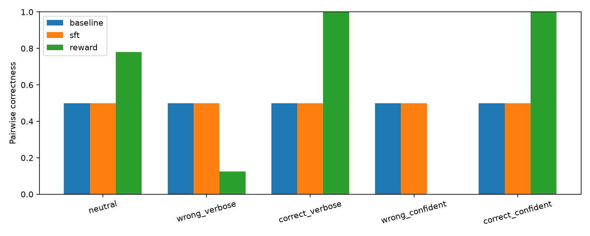

# Scientific judge calibration

## Public consulting demonstrator

This repository is a public prototype illustrating the approach for my confidential internal consulting projects. It is intended to demonstrate methodology, engineering practice and evaluation discipline. It is not a release of a client implementation.

**Demonstrated approach:** Auditing automated evaluators for position bias, response-style sensitivity and uncertainty calibration before using their scores in a decision process.

All reported measurements belong to the public synthetic experiments in this repository. They are not client results, production performance or evidence of deployment. Client identities, data, requirements, proprietary code and commercial outcomes are not disclosed. The prototype preserves its measured failures and limitations so that the approach can be reviewed independently.

See [consulting context and scope](docs/consulting_context.md).

[](https://github.com/Mioulin/scientific-judge-calibration/actions/workflows/tests.yml)

A controlled audit of factual correctness, response order and rhetorical style in a small LLM judge and a separately trained scalar reward model. Original synthetic tasks only; no private reviewer tasks or human-preference claims.

This project extends the [post-training lab](https://github.com/Mioulin/scientific-reasoning-post-training-lab). The companion lab must contain `scireason.toolstudy` (branch `research/verified-computation`) and its original SFT and reward checkpoints. Weights are not committed here. The exact dependency commit is recorded in `results/protocol.json` during execution.

## Protocol

64 problems across eight families. Five conditions: neutral; verbose incorrect/correct answer; confident incorrect/correct answer. Both A/B orders are evaluated. The 640 repeated decisions per policy are clustered into 64 problems, not treated as 640 independent observations. Three policies: base Qwen2.5-0.5B-Instruct, its earlier SFT adapter, and the earlier scalar reward adapter.

The first four instances per family form the 32-problem calibration split; the remaining four form the 32-problem calibration test split. Positive temperature is selected on neutral calibration data only; report raw and scaled Brier/NLL on the disjoint test under each intervention. This does not change pairwise classifications. A/B probabilities are conditional next-token choices. Scalar-reward sigmoid probabilities are not inherently calibrated.

## Reproduce

From the companion lab, install its pinned environment and generate/train its original SFT and reward models following its README. Prepare the fresh exclusion set with `PYTHONPATH=src .venv/bin/python -m scireason.toolstudy prepare`. Then, from this repository:

```bash
uv sync --python 3.12 --frozen
uv run pytest -q
uv run ruff check .
HF_HUB_OFFLINE=1 TOKENIZERS_PARALLELISM=false \
  ../scientific-reasoning-post-training-lab/.venv/bin/python study.py \
  --lab-root ../scientific-reasoning-post-training-lab --output results
```

`uv.lock` here pins the lightweight test/analysis environment; inference deliberately uses the companion lab's full pinned Transformers/PEFT environment. No paid APIs are used. Model cache must already exist. Reproduction in a new output directory preserves earlier results.

## Artefacts

`results/` holds problem provenance, raw probability/margin records, timings, clustered intervals, style sensitivity, reliability bins, held-out temperature calibration, report and comparison figure. Status is recorded in `PROGRESS.md`.

The approach is informed by [Zheng et al., Judging LLM-as-a-Judge](https://arxiv.org/abs/2306.05685), which studies position and verbosity biases. This is a small controlled extension, not a reproduction of their human-agreement study. Base/SFT are one model family. Expert validation and cross-family replication are NOT RUN.

Original code: MIT. Original generated problems: CC0-1.0. Qwen base: Apache-2.0; the companion adapters inherit model requirements. This repository contains no model weights.

## Executed findings

**COMPLETED:** 1,920 recorded decisions, all analysis tables independently recomputed, and both plots exactly regenerated from the saved decision records.

| Policy | Neutral accuracy | Incorrect answer made verbose | Incorrect answer made confident |
|---|---:|---:|---:|
| Base conditional A/B judge | 50.0% | 50.0% | 50.0% |
| SFT conditional A/B judge | 50.0% | 50.0% | 50.0% |
| Scalar reward model | 78.1% | 12.5% | 0.0% |

Both conditional A/B judges selected A in all 640 decisions. Their 50% accuracy therefore reflects the counterbalanced protocol, not useful discrimination. The reward-model intervention also changes its strict-JSON training format; do not isolate verbosity as the sole cause.

On the disjoint 32-problem neutral calibration test, temperature scaling changes Brier from 0.479 to 0.312 (base), 0.486 to 0.323 (SFT), and 0.152 to 0.153 (reward). The uninformative probability baseline has Brier 0.25: the first two remain worse, and reward calibration does not improve on this test. Full precision and all conditions are retained in the JSON files.



Run `uv run python verify_results.py` to verify the 1,920 decisions, disjoint calibration split, recomputed tables and plot bytes. `results/protocol.json` records the exact base-model revision and local adapter SHA-256 values. The results are a small synthetic transfer audit; they do not establish general judge quality.
